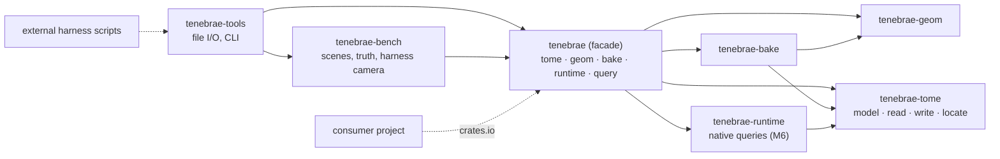
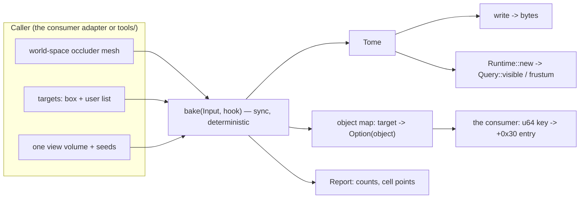

# Architecture Spine — Tenebrae

## Design Paradigm

**Functional core, imperative shell.** The library crates are the core: functions from in-memory values to in-memory values. `tenebrae-tools` is one shell: file formats, argument parsing, timing, and printing. The external harness scripts drive that shell. The consumer is a second shell that links the core through the facade crate `tenebrae`, from crates.io (AD-14).

Since 2026-10-13 (`docs/implementation-artifacts/spec-workspace-crate-split.md`) the core is four crates under `crates/` plus the facade:



Arrows are the only permitted dependency directions. `tenebrae-tome` and `tenebrae-geom` depend on nothing. `tenebrae-tools` depends on `tenebrae-bench` only for `truth::camera`, so the `query` tool builds the benchmark's cameras exactly as the bench and the external harness do.

## Invariants & Rules

### AD-1 — Pure, dependency-free library [ADOPTED]

- **Binds:** every library crate. By rule: every workspace crate except `tenebrae-tools` and `tenebrae-bench`. Today these are `tenebrae-tome`, `tenebrae-geom`, `tenebrae-bake`, `tenebrae-runtime` and the facade `tenebrae`.
- **Prevents:** the core becoming unusable from the consumer's core crates. Those crates are barred from I/O, threading crates, `getrandom`, clocks, and async runtimes (the consumer's boundary check). It also prevents a newly added crate from escaping the rule because a list left it out.
- **Rule:** No filesystem, network, process, GPU, environment, or clock access (`std::time::Instant` and `SystemTime` included). Callers pass bytes and values. `[dependencies]` holds workspace crates only, and `unsafe` is forbidden. Anything that reads or writes files, or measures time, goes in `tenebrae-tools` or `tenebrae-bench`; callers time a call from outside it, and library counters carry counts, never durations. [amended 2026-10-13: crate split; bound by rule after the oracle's removal; clock named explicitly]

### AD-2 — Crate layering [ADOPTED]

- **Binds:** every library crate (AD-1) and the facade
- **Prevents:** the format layer depending on baking or geometry, the baker depending on the runtime, or the runtime depending on the baker.
- **Rule:** Dependencies follow the diagram above, enforced by each crate's `Cargo.toml`. `tenebrae-tome` and `tenebrae-geom` depend on nothing. `tenebrae-runtime` depends only on `tenebrae-tome`. `tenebrae-bake` depends on `tenebrae-geom` and `tenebrae-tome` (its cell points use `tenebrae_tome::locate`). Only the facade depends on `tenebrae-bake` or `tenebrae-runtime`. The facade has no Cargo features. [amended 2026-10-13: crate split; oracle and its feature removed]

### AD-3 — The model stores only what cannot be derived [ADOPTED]

- **Binds:** `tome` model, reader, writer, and baker output
- **Prevents:** a writer that carries bytes along instead of understanding them, and two sources of truth for one value.
- **Rule:**
  - `Tome` holds only non-derivable data, and `write` recomputes every derived structure: rank directories, node keys and widths, cell prefixes, counts, offsets, tile sizes, and section placement.
  - The baker fills the model and never writes derived fields.
  - `read` returns `Error::Unsupported` for a feature the model does not carry; it never silently drops one.
  - When `bake` writes `Header::params`, the string is informational and its grammar belongs to `bake`. No tool, script, or consumer parses settings back out of it; settings travel in `Params` and `Report`.

### AD-4 — Acceptance is tiered: in-repo truth, external parity [ADOPTED, amended 2026-10-13]

- **Binds:** format, baker, runtime and portal-order changes; `tenebrae-bench` baselines
- **Prevents:** self-validating tests that encode the crate's own misunderstanding, and a runtime change and a baker change ratcheting against each other through one baseline rewrite.
- **Rule:**
  - **Format.** A format change is accepted when stock tomes still round-trip byte for byte (`crates/tenebrae-tome/tests/` over `TENEBRAE_TOMES`), run locally by a maintainer.
  - **Baker, in repo.** A baker change is gated by `tenebrae-bench`. It scores visibility with the native runtime, which is conservative against the engine (it never culls an object the engine keeps and may keep more), and against ray-cast truth. Tolerances are anchored to the committed Umbra reference (`reference/umbra.txt`), not only to Tenebrae's own baseline.
  - **Engine parity.** Parity with the engine (statuses, objects kept, captured views) is claimed only from the external harness. A change to the runtime, the writer, or portal ordering is accepted only through it.
  - **Baselines.** One `baseline.txt` rewrite never covers a runtime change and a baker change together. Each lands in its own commit, with the reason.
  - Game data never enters this repository.

### AD-5 — Deterministic output [ADOPTED, amended 2026-10-13]

- **Binds:** `bake`, `write`, the tile cache, `tenebrae-runtime` answers, and any sparse-grid containers
- **Prevents:** builds whose bytes differ from run to run, platform to platform, or between a cached and a fresh bake.
- **Rule:**
  - The same input and params produce identical bytes. Hash containers may aggregate data, but nothing may depend on their iteration order. Ordering comes from sorted keys or total orders. No randomness, wall-clock time, or thread scheduling may affect output.
  - Pinned hashes and the bench baseline hold on every CI platform (AD-15). A platform difference is a bug, not a second baseline.
  - The tile-cache key includes the crate version and the cache format version. Any change to a tile pass's output bumps the cache format version in the same commit, so neither a release nor an unreleased revision reuses a stale tile.

### AD-6 — Engine space, metres, `f32`; valid inputs

- **Binds:** every public geometric value and `bake::Input`
- **Prevents:** a frame or unit mismatch with the consumer, which fails silently as wrong culling. It also prevents callers and the baker disagreeing on what a usable input is.
- **Rule:**
  - All coordinates are engine world space (right-handed, X-forward, Z-up), in metres, as `f32`. Occluders arrive either as a world-space soup or as meshes placed by `bake::Instance`s (row-major 3×4 affine transforms), which the bake applies with `Instance::apply`'s fixed `f32` operation order; an instanced input bakes byte-identically to its applied soup. Tenebrae has no notion of tags or engine keys. [amended 2026-10-12, M4 D1]
  - `Input` and the M4 API use only `tome::Aabb` and `[f32; 3]`. `geom::Bounds` never appears in them.
  - A box is valid when it is finite and `min <= max` on every axis.
  - An invalid box, a non-finite vertex or transform, an out-of-range triangle or mesh index, a triangle total over `u32::MAX`, or a non-empty `owners` whose length differs from `triangles` returns `Error::Params`.
  - Seeds outside the domain are ignored, and `Report` counts the seeds used. With `SolidMode::Flood`, seeds given but none inside the domain returns `Err`.
  - `Mesh::owners` does not affect a bake; identity enters only through `Target::users`.

### AD-7 — One call: synchronous, one view volume, one tome; shared runtime [ADOPTED]

- **Binds:** `bake`, `voxelize`, the bake API, `tenebrae-runtime`
- **Prevents:** a baker or runtime that forces threads on the consumer's core crates, where threading crates are banned and adapters own threading (the consumer AD-25: long work reported as counted units). It also prevents incompatible progress or batching models.
- **Rule:**
  - One bake call is one view volume, which produces one tome and one object map. Several bubbles, and tome A plus tome B, mean several calls made by the caller, in parallel if it likes.
  - Calls block on the caller's thread. Every input and output value type is `Send`.
  - Inside a call, the per-tile stage may run on `std::thread::scope` workers (std only; AD-1 holds). The thread count is a `Params` field, default 16. With 1 thread, nothing is spawned and all work runs on the caller's thread. Output is byte-identical for every thread count (AD-5). [user, 2026-10-11]
  - Progress goes through an optional hook passed as a separate argument (`&mut dyn FnMut(Progress) -> Control`), never as a field of `Input`. It is called on the caller's thread only: workers report finished tiles over a channel.
  - `Progress` carries a `#[non_exhaustive]` `Stage` enum, a `total` that is fixed for the stage, and a `done` that never decreases.
  - `Control::Stop` ends the bake with `Error::Cancelled` and no partial output.
  - **Runtime.** A `Runtime` decodes a tome once and is `Send + Sync`. A `Query` is per thread and reused across cameras. The runtime spawns no threads. Its answers depend only on the tome, the camera and the options, never on the thread or the platform. [added 2026-10-13, M6]

### AD-8 — Object identity: one object per surviving target, input order [ADOPTED in M4]

- **Binds:** `bake::Target`, the object map, `tome::Users`, the consumer adapter
- **Prevents:** the object map, user ids, and the visibility record's `+0x30` disagreeing. That would happen if the baker merged or renumbered objects without saying so, or if a consumer indexed objects by position.
- **Rule:**
  - Each surviving target becomes one tome object, in input order, with its box equal to `Target::bounds`, never shrunk, and with the user list `Target::users` as given (stock tomes give 15-37 % of their objects several users). No target is merged or deduplicated, even when user ids repeat. [amended 2026-10-12, M4]
  - By default a target is dropped only when reachability removed every cell it overlapped, as Umbra does (user, 2026-10-11). Buried targets, which overlap no cell, are kept.
  - With `Params::keep_every_target` (on in `Params::tome_a/b`), no target is dropped: object `i` is target `i`, and a target reachability would drop is an object listed in no cell, as a buried one is. [amended 2026-10-12, M4]
  - The object map is per bake: tome A and tome B baked from one list may differ, unless both keep every target.
  - The bake returns the map explicitly (`Baked::object_map`), as `Option<object index>` per target. Consumers read identity only through the map, never through `tome.users` by position.
  - Tenebrae does not encode the visibility record, its seeded key table, or `+0x30`. The caller maps each target to its u64 visibility keys (the consumer AD-33) and chooses `Target::users`.

### AD-9 — Errors are typed, displayable, and never panic on input

- **Binds:** every public fallible function
- **Prevents:** the consumer losing error causes when it wraps them with `thiserror`, and malformed input crashing the host.
- **Rule:**
  - Each fallible module has one public `Error` enum. Every public `Error` implements `Display` and `std::error::Error`, with a description for every variant.
  - Malformed tomes and invalid inputs (AD-6) return `Err`. Grid sizes are computed with checked arithmetic, and a grid over the memory limit is refused with a typed error before anything is allocated.
  - Panics, in debug and release builds alike, are reserved for internal invariant violations; arithmetic on input-derived values is checked or saturating.

### AD-10 — Public API is contract v2, versioned by the facade's semver [ADOPTED, amended 2026-10-13]

- **Binds:** every item the facade `tenebrae` exports
- **Prevents:** a contract that grows or breaks silently through re-exports, and a contract version that does not match what crates.io resolves.
- **Rule:**
  - **Contract v2** is the README's list: `bake::bake` and its types (`Input`, `Occluders`, `Instance`, `Target`, `Params` with `tome_a`/`tome_b`, `Baked`, `Report`, `Stage`, `Progress`, `Control`, `Hook`, `Error`); `query::{find_cell, Locator, transfer, CellVotes, global_cell_boxes, global_portals, PortalRect, cell_regions, leaves}`; and `runtime::{Runtime, Query, Camera, Depth, Options, Status, Counters, Error, visible, frustum}`, also under `query` (`docs/implementation-artifacts/spec-m6-native-runtime.md`). It is bound by AD-5 to AD-9 and AD-11.
  - **Closure.** Every type reachable from a contract item's signature or public fields (for example `tome::{Tome, Aabb, read, write}`, `geom::Mesh`, `bake::SolidMode`) is itself a contract item, and the facade exports it.
  - **Before the first publish** contract v2 may still drop items the rules forbid (`Counters::stage_ns`, AD-1); from the first publish on, only by a version bump.
  - **Versioning.** The contract version maps to the facade's semver. Before 1.0, contract vN is `0.N.x`; from 1.0 on, the contract version is the major version. A breaking change to a contract item bumps it and is named in the README. New `Params` or `Report` fields are not breaking and take a patch bump: `Report` is `#[non_exhaustive]`, and `Params` is built only from the presets with `..` (a consumer contract), so the semver check allows the added-field lint for `Params` alone.
  - **Surface.** The facade re-exports by explicit item lists, never by module (`pub use crate as name`) or glob. Anything not listed is outside the contract. `Voxels`, `voxelize`, `geom` and the `tome` model's internals stay outside it. CI runs `cargo-semver-checks` on all five published crates, against the last published version, or `--baseline-rev` before the first publish (AD-15); re-exported items are checked in the crate that defines them.
  - The tile cache bytes are opaque and versioned by the cache itself; a cache of another version is a miss, not a break (AD-5).

### AD-11 — Returned indices refer to the tome as written

- **Binds:** `Report` (`cell_samples` and any per-cell data), M3b compaction and collapse, the object map
- **Prevents:** per-cell data computed before unreachable-cell removal or tile collapse renumbers cells, which would silently mislabel light-probe or ambient data downstream.
- **Rule:** Every cell, object, or tile index a bake returns is an index into the returned `Tome` after every compaction step. It is valid only for that bake's output.

### AD-12 — `tenebrae-tools` is a cross-repo interface with the external research

- **Binds:** `crates/tenebrae-tools/src/bin/*`, the external harness scripts, pull requests that touch them
- **Prevents:** a tools change silently breaking the external research scripts, which call release binaries with positional arguments and read their output blobs.
- **Rule:**
  - Positional CLI arguments are append-only. A CLI default always equals the matching `Params::default()` value.
  - Each blob layout is documented in its binary's `//!` header, and new blob formats start with a magic and version word.
  - A change to arguments or a layout updates the external harness scripts before it merges. A pull request from outside that changes harness-facing behaviour, or anything AD-4 sends to the external harness, is run through the harness by a maintainer before merge.

### AD-13 — The runtime is clean-room [ADOPTED, amended 2026-10-13]

- **Binds:** `tenebrae-runtime`, any public release
- **Prevents:** publishing code derived from the runtime of a proprietary engine.
- **Rule:** `tenebrae-runtime` is written from the format reference and the typed model only. It carries no engine addresses, decompiled code, or code ported from the engine's runtime. The engine's runtime is reached only through the external harness (AD-4).
- **History:** M5 shipped an in-repo port of the engine's runtime (`tenebrae-oracle`, `publish = false`) as the acceptance oracle for M6. Once the native runtime passed its gates (2026-10-13), the oracle and the bench tests that compared against it were deleted.

### AD-14 — Lockstep release to crates.io [ADOPTED, user 2026-10-13]

- **Binds:** every `Cargo.toml`, release tags, `.github/workflows/release*`
- **Prevents:** a consumer resolving two copies of `tenebrae-tome` (two `Tome` types, so `bake`'s output stops type-checking as `Runtime::new`'s input), and a publish that fails or ships an untested combination.
- **Rule:**
  - One workspace version for every crate (`[workspace.package] version`).
  - The five library crates publish. `tenebrae-tools` and `tenebrae-bench` have `publish = false` forever.
  - Each `[workspace.dependencies]` entry carries `path` and `version = "=X.Y.Z"` (the workspace version).
  - A tag `vX.Y.Z` on `main` publishes all five from GitHub Actions, in dependency order (`tenebrae-tome`, `tenebrae-geom`, then `tenebrae-bake`, `tenebrae-runtime`, then `tenebrae`), through crates.io trusted publishing (`rust-lang/crates-io-auth-action`, job permission `id-token: write`). The first publish of each crate is manual.
  - The release workflow reruns AD-15's full gate set on the tagged commit and publishes only if it passes. [amended 2026-10-13: until the AD-15 CI upgrade in deferred-work.md lands, the release reruns the gates .github/workflows/ci.yml has today]
  - Before tagging, a maintainer runs the stock-tome round trip and, for any change AD-4 sends there since the last release, the external harness, and records the outcome in the tag's release notes.
  - Library crates never depend, including as dev-dependencies, on `tenebrae-tools` or `tenebrae-bench`; a release cannot stop after a partial publish for that reason.
  - Every published crate carries `license`, `description`, `repository`, `readme`, `keywords` and `categories`.

### AD-15 — CI on Windows and Linux, self-contained [ADOPTED, user 2026-10-13]

- **Binds:** `.github/workflows/*`, `.githooks/pre-commit`
- **Prevents:** a gate that passes locally and fails in CI (or the reverse), game data leaking into CI, and a vacuous pass mistaken for acceptance.
- **Rule:**
  - On every push and pull request, `windows-latest` and `ubuntu-latest` run `cargo fmt --all -- --check`, `cargo clippy --workspace --all-targets -- -D warnings`, `cargo test --release`, and `cargo test --release -p tenebrae-bench`. A separate job checks MSRV 1.95, and `cargo-semver-checks` runs on the facade (AD-10).
  - The pre-commit hook and CI run the same fmt and clippy commands.
  - CI never sets `TENEBRAE_TOMES` and holds no game data, in the repository or in secrets. A test that passes vacuously without tomes is not acceptance (AD-4).
  - CI needs nothing outside the repository. External-harness acceptance stays a maintainer step (AD-4, AD-12).

## Consistency Conventions

| Concern | Convention |
| --- | --- |
| Naming | Umbra/runtime terms as the format names them (tile, cell, portal, global cell, view tree, user). Header fields documented with their `+0xNN` offset. |
| Data & formats | Vectors are `[f32; 3]`. Boxes are `tome::Aabb` at every public boundary. Little-endian everywhere. Counts and indices are `u32` in the model and `usize` in computation. |
| State | No global or static mutable state. All configuration arrives in `Params`, whose `Default` is the validated setting. |
| Gates | `cargo fmt --all -- --check` and `cargo clippy --workspace --all-targets -- -D warnings` pass on every commit (`.githooks/pre-commit`) and in CI (AD-15). Library crates use `lints.workspace = true`; `tenebrae-tools` and `tenebrae-bench` declare their own lints, forbid `unsafe`, and deny `clippy::all`. |

## Stack

| Name | Version |
| --- | --- |
| Rust toolchain | 1.97.1 (pinned, same as the consumer; current stable 1.99.0 as of 2026-10-13), target `x86_64-pc-windows-msvc` locally; CI adds `x86_64-unknown-linux-gnu` (AD-15) |
| Edition / MSRV | 2024 / 1.95 (checked in CI, AD-15) |
| Crate dependencies | none |
| Format implemented | Umbra 3.3.6 tome, version 18 |
| Release | crates.io via GitHub Actions trusted publishing (`rust-lang/crates-io-auth-action` v1.0.5, verified 2026-10-13) |
| Semver check | `cargo-semver-checks` 0.51 (needs Rust ≥ 1.93; verified 2026-10-13) |
| Workflow actions | pinned by full commit SHA with the version in a comment |

## Structural Seed

```text
Tenebrae/
  Cargo.toml                       # virtual workspace; default members = all but the benchmark
  .github/workflows/               # ci (AD-15), release (AD-14)
  crates/tenebrae-tome/src/        # lib (model), bits, read, write, locate (find_cell, leaves, transfer, …)
  crates/tenebrae-tome/tests/      # round trip over TENEBRAE_TOMES
  crates/tenebrae-geom/src/        # Mesh, Bvh, segment occlusion, triangle/box
  crates/tenebrae-bake/src/        # lib (bake, Params, Input, Report), tile, grid, global, lod, group, cache, reference, tests
  crates/tenebrae-runtime/src/     # native queries (M6): decode, camera, coverage, traverse, query
  crates/tenebrae/src/lib.rs       # facade: tome, geom, bake, runtime, query (explicit re-exports, AD-10)
  crates/tenebrae-tools/src/bin/   # bake, cells, diagnose, edit, inspect, query, truth (file I/O adapters)
  crates/tenebrae-bench/           # scenes, truth, baseline gates, assets, Umbra reference
```



## Deferred

- **The consumer's side of the bake API:** the consumer's AD-33 currently says "the consumer never registers a key and never authors a tome", and its PRD keeps tome generation out of V2. The consumer must amend AD-33 (Ask First there). Decided in the consumer, not here.
- **Visibility record ownership:** AD-8 keeps the record's dependent tables in the consumer until the external research resolves the record's hash seed. Revisit then.
- **Multiple view volumes:** AD-7 bakes one per call. Unions or multi-volume domains wait for a map that needs them.
- **How the consumer consumes the crate:** from crates.io at a pinned version (AD-14) once published; until then a path or git dependency pinned to a full revision (the consumer AD-14, Ask First there).
- **Replacing the consumer's own tome reader:** the consumer's codec crate has a separate object-box reader and a findCell port. Merging them is the consumer's call. Until then, any disagreement is settled against the engine's native runtime (AD-4).
- **Per-bake object maps vs the consumer's record:** settled by `keep_every_target` (identity maps). Stock tome B has a different object count from tome A in every installed pair (the parity scene 3,385 / 3,422), so the A→B table is a real remap; whether the engine queries B, and with which cameras, is an external research question.
- **Gates (openable portals) and plane BSP leaves:** the model reads and writes them, but the baker never emits them and the runtime's gate handling is untested on real data. They stay out until a map needs them.
- **Runtime speed:** the ≤ 1.5× engine median target (M6) is open; it binds no interface.
